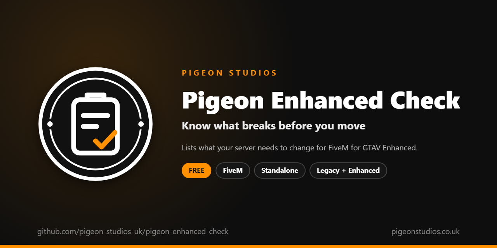

<div align="center">
  

  <h1>Pigeon Enhanced Check</h1>

  <p><strong>Scans your server's resources and settings and lists what to change before moving to FiveM for GTAV Enhanced.</strong></p>

  <p>
    <a href="https://github.com/pigeon-studios-uk/pigeon-enhanced-check/releases/latest"></a>
    <a href="LICENSE.md"></a>
    <a href="https://discord.gg/2NFVWEUmDF"></a>
    
  </p>

  <p>
    <a href="https://github.com/pigeon-studios-uk/pigeon-enhanced-check/releases/latest"><strong>Download</strong></a> ·
    <a href="#installation">Install</a> ·
    <a href="#what-it-checks">What it checks</a> ·
    <a href="CHANGELOG.md">Changelog</a> ·
    <a href="https://discord.gg/2NFVWEUmDF">Support</a>
  </p>
</div>

---

## Contents

- [Overview](#overview)
- [Features](#features)
- [What it checks](#what-it-checks)
- [What it can't check](#what-it-cant-check)
- [Example report](#example-report)
- [Requirements](#requirements)
- [Installation](#installation)
- [Updating](#updating)
- [Using it](#using-it)
- [Commands](#commands)
- [Permissions](#permissions)
- [Configuration](#configuration)
- [Localisation](#localisation)
- [How it works](#how-it-works)
- [Privacy](#privacy)
- [Update checker](#update-checker)
- [Performance](#performance)
- [Security](#security)
- [Troubleshooting](#troubleshooting)
- [FAQ](#faq)
- [Support](#support)
- [Contributing](#contributing)
- [Licence](#licence)
- [Credits](#credits)

## Overview

Pigeon Enhanced Check is a free resource by [Pigeon Studios](https://pigeonstudios.co.uk) for server owners getting ready to move to **FiveM for GTAV Enhanced**.

Enhanced keeps your Lua, JavaScript and C# scripts working, but plenty else changes: escrowed resources can't run there yet, models and textures made for Legacy need converting, OneSync is always on, Mumble voice is on its way out, NUI callbacks are locked to their own resource, player IDs get reused, and a handful of server settings stop doing anything. Cfx.re lists all of it on [What's Changed in FiveM for GTAV Enhanced](https://docs.fivem.net/docs/developers/legacy-vs-enhanced/), but working out which of your hundred-odd resources are affected means opening every one of them.

This resource does that for you. Start it on the server you have now, and it reads every resource's manifest, folders and scripts, and your server's settings, then gives you one report: what won't work, what to change, what to look at, and exactly which files and lines it found. It changes nothing, runs once, and sends nothing anywhere.

## Features

- **Every resource checked at once:** each started resource's manifest, files, scripts and NUI, plus your server's settings.
- **Sorted by how much it matters:** blockers, things to change, things to review, and notes, each with what to do about it in plain English.
- **Files and line numbers:** the saved report shows where each finding came from, so you (or the resource's creator) can go straight to it.
- **Based on Cfx.re's own documentation:** every check matches a documented change, so it doesn't guess. See [What it checks](#what-it-checks).
- **Read-only:** it never changes, starts, stops or writes to another resource. The only file it writes is its own report.
- **Runs where you are:** made for checking a Legacy server before you move, and works on an Enhanced server too.
- **One resource at a time:** `enhancedcheck <resource>` checks just one, handy for creators testing their own work.
- **23 languages:** every message is in `locales/`, following ox_lib's language setting.
- **Free:** use it on as many servers as you like.

## What it checks

Each check comes from Cfx.re's documentation: [What's Changed in FiveM for GTAV Enhanced](https://docs.fivem.net/docs/developers/legacy-vs-enhanced/), [Alchemist](https://docs.fivem.net/docs/alchemist/), [Voice](https://docs.fivem.net/docs/scripting-manual/voice/#fivem-for-gtav-enhanced) and [NUI callback strict mode](https://docs.fivem.net/docs/scripting-manual/nui-development/nui-callbacks/#nui-callback-strict-mode).

### Blockers: won't work on Enhanced as they are

| Check | What it looks for | Why |
|---|---|---|
| Escrowed resources | A `.fxap` file in the resource | Asset escrow isn't implemented on Enhanced yet |
| Resource builders | `RegisterResourceBuildTaskFactory` in server scripts, as the `yarn` and `webpack` builders from cfx-server-data use | Resources can no longer be builders |

### To change: before, or as, you move

| Check | What it looks for | Why |
|---|---|---|
| OneSync is off | `onesync` set to `off` | Enhanced has no P2P mode; OneSync is always on |
| OneSync legacy mode | `onesync` set to `legacy` | Non-big mode no longer exists; big mode is the only one |
| Models and textures to convert | YDR, YTD, YFT, YPT or YDD files in `stream/`, and no `stream_enhanced/` folder | Legacy models and textures need converting with Alchemist, and go in `stream_enhanced/` |
| C# resources | `.net.dll` files | Mono was replaced by .NET (built with the .NET 10 SDK) |
| Mumble voice | Mumble natives (`MumbleSetVoiceTarget` and the rest) in client scripts | Mumble is deprecated, works only with `sv_mumble`, and will be removed |
| Removed voice settings | `voice_use2dAudio`, `voice_use3dAudio`, `voice_useSendingRangeOnly` or `voice_useNativeAudio` turned on | These convars no longer exist |
| NUI calls to other resources | NUI files that call another resource's callbacks (`https://other-resource/...`), in a resource without `nui_callback_strict_mode 'false'` | Strict mode is on by default, and blocks those calls |
| Server key-value storage | `SetResourceKvp`, `GetResourceKvp…`, `DeleteResourceKvp…` or `StartFindKvp` in server scripts | The server's KVP database must be migrated with [kvdb-migrator](https://github.com/citizenfx/kvdb-migrator) |
| Developer mode through moo | `moo` set to `31337` | No longer turns on developer mode; use `sv_devMode true` |

### To review: may be affected

| Check | What it looks for | Why |
|---|---|---|
| Data kept per player ID | Server tables indexed by `source`, `src`, `playerId` and similar, in a resource that never handles `playerDropped` | Player IDs are freed and reused on Enhanced, so leftover data could go to the next player |
| Enforced game build | `sv_enforceGameBuild` set to anything but `1` | Only the latest build is supported (or `1`, the base game) |

### Notes: nothing has to change yet

| Check | What it looks for | Why |
|---|---|---|
| Uses the stream folder | Files in `stream/` and no `stream_enhanced/`, but nothing Alchemist converts | `stream/` still works, but it's deprecated |
| State bag handlers | `AddStateBagChangeHandler` | Handlers only fire if the entity exists, and values are only replicated when set explicitly |
| Settings that do nothing | `onesync_enableBeyond`, `sv_enhancedHostSupport`, `sv_protectServerEntities`, `onesync_automaticResend` or `sv_netHttp2` turned on | They're kept only for compatibility, or were removed |
| sv_useAccurateSends | `sv_useAccurateSends` turned off | Deprecated; set `sv_syncTickRate` instead |

Scripts are searched with their comments taken out, so commented-out code isn't reported. Code is only searched in the files the manifest loads, on the side it runs (client, server or both), so a client-only native in a server file isn't reported, and neither is anything in `node_modules`.

## What it can't check

Some changes aren't in any file a resource can read, or need a person to judge. The report file lists these at the end so they aren't forgotten:

- **Server files:** the download is `cfx-server_win_x64` or `cfx-server-linux_x64`, and `FXServer.exe` is now `cfx-server.exe`. Start scripts, shortcuts and hosting panels need updating.
- **Windows servers** need the [Microsoft Visual C++ 2017 Redistributable](https://aka.ms/vs/17/release/vc_redist.x64.exe).
- **Endpoints:** `endpoint_add_tcp` and `endpoint_add_udp` take a single endpoint each. FXServer's sandbox doesn't let resources read `server.cfg`, so this can't be checked.
- **Graphic mods** can't be used during early access, because pure mode is always on.
- **Remote commands** only send output back with `PrintRemoteCommandLog(message)`.
- **Remote Console (DevCon)** is off by default, and uses port 29200.
- **Players** need GTA V Enhanced, and the server runs only the latest game build.

And above all: **this report is a guide, not a guarantee.** It finds the documented problems by reading files and settings. It can't run your resources on Enhanced, and it can't see inside escrowed files. Test on an Enhanced server before you move your players.

## Example report

What the console shows after `enhancedcheck` (shortened):

```text
[Pigeon Enhanced Check] Checked 148 resources and the server's settings in 2.4s.
[Pigeon Enhanced Check] 2 blockers · 6 to change · 3 to review · 4 notes · nothing found in 133 of 148 resources

[Pigeon Enhanced Check] BLOCKERS: won't work on Enhanced as they are
[Pigeon Enhanced Check]   Escrowed resources (2)
[Pigeon Enhanced Check]     - example-escrowed-hud
[Pigeon Enhanced Check]     - example-escrowed-garage
[Pigeon Enhanced Check]     Asset escrow isn't implemented on FiveM for GTAV Enhanced yet, so these can't run there as they
[Pigeon Enhanced Check]     are. Ask each creator about an Enhanced build, and keep them on your Legacy server until then.

[Pigeon Enhanced Check] TO CHANGE: change these before, or as, you move
[Pigeon Enhanced Check]   Models and textures to convert (3)
[Pigeon Enhanced Check]     - example-map-pack: 214 of the 230 files in stream/
[Pigeon Enhanced Check]     - example-vehicles: 96 of the 96 files in stream/
[Pigeon Enhanced Check]     - example-clothing: 1840 of the 1840 files in stream/
[Pigeon Enhanced Check]     These stream Legacy models or textures (YDR, YTD, YFT, YPT, YDD) from stream/ and have no
[Pigeon Enhanced Check]     stream_enhanced/ folder. Convert them with Cfx.re's Alchemist and put the results in ...
[Pigeon Enhanced Check]   Mumble voice (1)
[Pigeon Enhanced Check]     - example-voice: 38 Mumble call(s)
...
[Pigeon Enhanced Check] The full report, with files and line numbers, is in pigeon-enhanced-check/enhanced-report.txt.
```

The report file has the same findings, with the files and lines each one came from:

```text
Mumble voice (1)
  Mumble is deprecated on Enhanced and will be removed. Its natives only work there with setr
  sv_mumble true, which lets any player join any voice channel, ...

  - example-voice: 38 Mumble call(s)
      client/main.lua:41
      client/main.lua:58
      client/radio.lua:12
```

The resource names above are examples.

## Requirements

| Requirement | Version | Notes |
|---|---|---|
| FXServer | A [recommended artifact](https://runtime.fivem.net/artifacts/), Legacy or Enhanced | |
| Chat | Any resource that handles `chat:addMessage` | Only for replies when staff use the command in game. The default `chat` resource is fine |

**Frameworks:** none. It works the same on any server, whatever framework it runs.

## Installation

1. **Download** `pigeon-enhanced-check.zip` from the [latest release](https://github.com/pigeon-studios-uk/pigeon-enhanced-check/releases/latest). Don't use the green **Code** button; release zips are the tested builds.
2. **Extract** it into your server's `resources` folder. The folder must be called `pigeon-enhanced-check`.
3. **Start it** by adding this to `server.cfg`. It can go anywhere; it waits for the other resources to start before checking.

   ```cfg
   ensure pigeon-enhanced-check
   ```

4. **Optional:** let staff run the check in game (see [Permissions](#permissions)).
5. **Restart** your server. About 20 seconds after it starts, the console shows a two-line summary, and the full report is saved to `enhanced-report.txt` in the resource's folder.

When you've moved and everything's sorted, you can remove it. It's only needed while you're getting ready.

## Updating

1. Read the [changelog](CHANGELOG.md) for the versions between yours and the latest, especially any **Upgrade notes**.
2. Back up your `configuration/` folder.
3. Replace the resource folder with the new release.
4. Copy your settings back into the new `configuration/config.lua`. Don't copy the old file over the new one; new versions can add settings.
5. Restart the resource.

New versions add checks as Cfx.re documents more changes, so update before you rely on a report.

## Using it

**When the server starts** (`Config.CheckOnStart`), it waits `Config.StartDelaySeconds`, checks everything, prints a two-line summary in the server console and saves the full report:

```text
[Pigeon Enhanced Check] Checked 148 resources and the server's settings in 2.4s.
[Pigeon Enhanced Check] 2 blockers · 6 to change · 3 to review · 4 notes · nothing found in 133 of 148 resources
[Pigeon Enhanced Check] The full report, with files and line numbers, is in pigeon-enhanced-check/enhanced-report.txt.
[Pigeon Enhanced Check] Type enhancedcheck in the server console for the full report.
```

**Type `enhancedcheck`** in the server console (or txAdmin's live console) to check again and print the full report, grouped by check, with what to do about each.

**Open `enhanced-report.txt`** in the resource's folder for the same report with the files and line numbers each finding came from, and the list of things to check by hand. It's plain text, so you can send it to a resource's creator or paste it into a ticket. It's replaced every time the check runs.

**Work through it from the top.** Blockers first: these need the creator, or a replacement resource. Then the changes, most of which are a convar in `server.cfg` or a run of Alchemist or kvdb-migrator. Then the reviews, which need someone who knows the resource to have a look. Notes are for later.

**Check one resource** with `enhancedcheck <resource>`, which prints its findings with files and line numbers. Server settings aren't checked when you name a resource. Creators can use this to check their own resources before they release an Enhanced version.

## Commands

| Command | Who can use it | What it does |
|---|---|---|
| `enhancedcheck` | Server console, or staff with the permission below | Checks every started resource and the server's settings, prints the full report in the server console and saves the report file |
| `enhancedcheck <resource>` | The same | Checks one resource (started or not) and prints its findings with files and line numbers |

The command name can be changed with `Config.Command`. In game, staff type it with a slash (`/enhancedcheck`). The report always goes to the server console and the report file, never to chat, because it can be long; staff get a chat message saying it's done.

## Permissions

The server console can always use the command. To let staff use it in game, grant the ACE permission in `server.cfg`:

```cfg
add_ace group.admin pigeon-enhanced-check.use allow
```

The permission name can be changed with `Config.Permission`.

## Configuration

All settings are in `configuration/config.lua`, each with a comment explaining it.

| Setting | Default | What it does |
|---|---|---|
| `Config.Locale` | `'auto'` | Language: `'auto'` follows ox_lib's language, or a code from `locales/` such as `'de'` |
| `Config.CheckOnStart` | `true` | Check once when the server starts and print a short summary. Off, it only checks when the command is used |
| `Config.StartDelaySeconds` | `20` | How long to wait after the server starts before checking, so every resource has started |
| `Config.IncludeStopped` | `false` | Also check resources in your resources folder that aren't started. Off, only what the server actually runs is checked |
| `Config.Ignore` | `{}` | Resources never to check, by folder name |
| `Config.ReportFile` | `'enhanced-report.txt'` | Where the full report is saved, inside this resource's folder. `''` doesn't save it |
| `Config.Command` | `'enhancedcheck'` | The command's name |
| `Config.Permission` | `'pigeon-enhanced-check.use'` | The ACE permission staff need to use the command in game |

## Localisation

Pigeon Enhanced Check comes in 23 languages: `en` English, `cs` Czech, `da` Danish, `de` German, `es` Spanish, `et` Estonian, `fi` Finnish, `fr` French, `hr` Croatian, `hu` Hungarian, `id` Indonesian, `it` Italian, `nl` Dutch, `no` Norwegian, `pl` Polish, `pt` Portuguese, `pt-br` Brazilian Portuguese, `ro` Romanian, `sl` Slovenian, `sv` Swedish, `tr` Turkish, `zh-cn` Simplified Chinese and `zh-tw` Traditional Chinese. They're the languages ox_lib ships, so your server may already have one set.

With `Config.Locale = 'auto'` (the default), it uses ox_lib's language, so one line in `server.cfg` sets it for this and every other resource that follows ox_lib:

```cfg
setr ox:locale "de"
```

Use `setr`, not `set`, so players' games get it too. Without it, or for a language that isn't in `locales/`, the text is English. To choose a language for this resource only, set `Config.Locale` to its code, such as `'fr'` or `'pt-br'`.

Every file was checked for missing text and placeholders, but not every translation has been read by a native speaker yet. If something reads wrong, please send a fix; see [Contributing](#contributing). To add a language, copy `locales/en.lua` to a new file named with the language's code (such as `ja.lua`), change `Locales.en` at the top to match (`Locales.ja`), and translate the text in quotes. Keep words in `{curly brackets}`, convar names, file names and commands as they are.

## How it works

Everything runs on the server, once per check.

1. It goes through every resource FXServer knows about, and picks the started ones (or all of them, with `Config.IncludeStopped`), leaving out itself and `Config.Ignore`.
2. For each one, it lists the resource's folder, skipping `.git` and `node_modules`, to find escrow files, `.net.dll` files and what's in `stream/` and `stream_enhanced/`.
3. It reads the manifest through FXServer itself (`GetResourceMetadata`), so it sees exactly what the server loaded, including `client_scripts`, `server_scripts` and `shared_scripts` with their wildcards, `ui_page`, `files` and `nui_callback_strict_mode`.
4. It reads the Lua and JavaScript files the manifest loads, takes out comments, and searches each one for the natives in [What it checks](#what-it-checks), only on the side the file runs. Scripts over 2 MB are bundles and aren't searched. NUI pages and scripts listed in `files` are searched for calls to other resources' callbacks.
5. It reads the server settings in [What it checks](#what-it-checks) with `GetConvar`.
6. It sorts the findings, prints them, and saves the report file with `SaveResourceFile`.

Folders are listed with `io.readdir`, which FXServer's [sandbox](https://docs.fivem.net/docs/developers/sandbox/) provides on current artifacts. On older artifacts without it, folders are listed with `dir` (Windows) or `ls` (Linux), the only commands the sandbox allows. The sandbox lets resources read other resources' folders but never write to them, and keeps them out of the server's own folder, which is why `server.cfg` can't be read.

## Privacy

Pigeon Enhanced Check reads your resources' files and your server's settings on your server, and that's where the results stay: in your server console and in the report file in its own folder. Nothing about your server, resources or players is sent anywhere. It doesn't read player data at all. The only request it makes is the update check below.

The report file names your resources and some of your server settings, and shows the paths inside each resource. Think about that before you post it in public.

## Update checker

When it starts, Pigeon Enhanced Check checks our public [version registry](https://github.com/pigeon-studios-uk/pigeon-versions) once and prints one line in the server console saying whether it's up to date. If there's an update, it shows what's new and where to get it. The check is a single request to GitHub and sends nothing about your server or players.

Control it for every Pigeon Studios resource at once in `server.cfg`:

```cfg
set pigeon_update_check "on"      # default: one short line
set pigeon_update_check "quiet"   # only print when there's an update or a problem
set pigeon_update_check "off"     # never check
```

## Performance

Nothing runs on the client at all, and nothing runs on the server between checks: it idles at 0.00 ms.

A check reads files from disk, so it takes a few seconds on a big server, and longer on slow disks or servers with tens of thousands of files. It pauses between resources so the server keeps running, but the start-up check is timed for before players join, and it's best to run the command when the server is quiet.

## Security

- It only reads. The sandbox stops resources writing to other resources, and this one doesn't try: the only file it writes is its own report.
- It never runs other resources' code; it reads it as text.
- The command checks the ACE permission on the server every time it's used, and the console can always use it.
- It sends nothing to players except a "done" chat message to the staff member who ran the command.

Found a problem? Please don't open a public issue. Use the **Report a vulnerability** button in this repository's **Security** tab, or follow our [Security Policy](https://github.com/pigeon-studios-uk/.github/blob/main/SECURITY.md).

## Troubleshooting

**Nothing appears when the server starts.**
The check waits `Config.StartDelaySeconds` (20 by default). Make sure `Config.CheckOnStart` is `true` and the resource is started (`ensure pigeon-enhanced-check`). You can always type `enhancedcheck` in the console.

**A resource is listed as "couldn't be read".**
Its folder couldn't be listed. Check it exists where the server expects it. On older artifacts, folders are listed with `dir` or `ls`; updating to a recommended artifact gives the resource `io.readdir` instead.

**A resource I know needs changing isn't listed.**
It only reports what Cfx.re has documented and it can see in files. Escrowed files can't be read, and code that builds native names at runtime, or is in a script over 2 MB, isn't found. Check the resource is started, or turn on `Config.IncludeStopped`, and that it isn't in `Config.Ignore`.

**A resource is listed under "Data kept per player ID", but it's fine.**
That check is a pattern search: it finds tables indexed by player ID in resources that never mention `playerDropped`. Some clear their data another way, such as a framework's own logout event. That's why it's under "To review", not "To change". Add the resource to `Config.Ignore` once you've checked it.

**The report file wasn't saved.**
The console says so. Make sure the server can write to the resource's own folder, and that `Config.ReportFile` is a plain file name such as `enhanced-report.txt`.

**`/enhancedcheck` says I don't have permission.**
Grant the ACE permission in [Permissions](#permissions), then reconnect.

## FAQ

**Do I need this on my Enhanced server?**
It's made for the server you have now, so you know what to fix before you move. It runs on Enhanced too, which is handy for checking resources you add later.

**Does it fix anything?**
No. It only reads and reports. Every fix is yours, or the resource creator's, to make. That way nothing changes on your server that you didn't choose.

**Will a clean report mean everything works on Enhanced?**
No. It means none of the documented problems it checks for were found. Test on an Enhanced server before you move. Early access is still changing, so update this resource as new versions add checks.

**Can creators use it?**
Yes. `enhancedcheck <resource>` checks one resource with files and line numbers.

**Is it really free?**
Yes. Use it on as many servers as you like, including servers that take donations. You just can't reupload, resell or bundle it. See [Licence](#licence).

**Can I change it?**
Yes, for your own servers. If you've fixed or improved something, please send it back as a pull request.

## Support

Read [Troubleshooting](#troubleshooting) first, then ask in the support channels of our [Discord](https://discord.gg/2NFVWEUmDF). Please include your Pigeon Enhanced Check version, FXServer artifact (Legacy or Enhanced) and any errors from the console. See [Getting help](https://github.com/pigeon-studios-uk/.github/blob/main/SUPPORT.md).

Found a bug, or a check that's wrong? Open a [bug report](https://github.com/pigeon-studios-uk/pigeon-enhanced-check/issues/new/choose).

## Contributing

Fixes, improvements and translations are welcome. Please read the [contributing guide](https://github.com/pigeon-studios-uk/.github/blob/main/CONTRIBUTING.md) first, and open a feature request before working on anything big. A new check needs a link to where Cfx.re documents the change.

## Licence

Pigeon Enhanced Check is free to use under the **[Pigeon Studios Free Licence](LICENSE.md)**.

- ✅ Use it on any number of servers, including monetised ones
- ✅ Change it for your own servers
- ✅ Show it in videos and streams
- ❌ Don't reupload, share or mirror the files; link to this repository instead
- ❌ Don't sell it, bundle it in packs, or put it behind escrow
- ❌ Don't remove the credits

This summary isn't the licence; [LICENSE.md](LICENSE.md) is. Third-party components are listed in [NOTICE.md](NOTICE.md).

## Credits

Made by [Pigeon Studios](https://pigeonstudios.co.uk). Thanks to everyone who has contributed fixes and translations; see the [changelog](CHANGELOG.md).

<sub>Not affiliated with or endorsed by Rockstar Games, Take-Two Interactive or Cfx.re.</sub>
